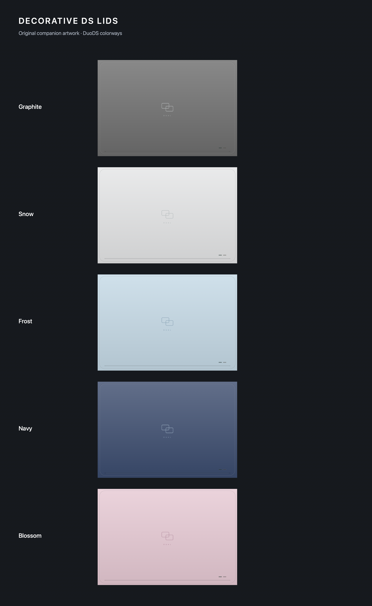

# Decorative DS lids

This experimental feature changes the image drawn by Delta's existing closing-lid view. It does not introduce a new fold interaction or change emulation/sleep behavior.

## Use

Enable **Decorative DS Lids** in Experimental Features (beta builds). On iPhone Duo, open **Settings → Controller Skins → Nintendo DS → Inside or Outside**. Tap **Closed-Lid Cover…** beneath the portrait or landscape skin preview. Choose a companion design, import a PNG/JPEG from Files, preview charging, or reset.

Selections belong to the controller skin's identifier, including when that skin is used in another orientation or game. Different skin files retain independent selections. Imported images use centered aspect fill; the preview uses the standard DS cover's aspect ratio. Reset restores the coordinated DuoDS default, or the skin's own decorative cover followed by the standard DS cover. The existing Show Cover Skins setting still controls whether a closing-lid cover appears.

## Implementation

- `LidCoverStore` persists a skin identifier → selection mapping using the experimental feature's hidden `@Option`. Imported image bytes are stored under Application Support/Decorative Lid Covers using generated UUID filenames. Replacing/resetting a selection removes its previous image when no other selection references it.
- `LidCoverImageImporter` accepts still PNG/JPEG files up to 30 MB, decodes directly from a file-backed ImageIO source, applies orientation, downsamples to a maximum edge of 2048 pixels, and atomically saves normalized PNG data. Invalid imports leave the current selection intact. Missing/corrupt saved images fall back to defaults.
- `CoverView` retains both the selected controller skin and the existing fallback cover skin. This preserves the selection key when a third-party skin lacks a `.cover` representation. Artwork refreshes on feature/selection changes, skin changes, and charging updates. Existing animation, hinge handling, and delegates remain intact.
- No database migration, public DeltaCore API change, skin format change, or cloud sync is introduced. Imported images and selections are local to this device. With the feature disabled, the original artwork resolution path is used.

## Original companion artwork

Five colorways: Graphite, Snow, Frost, Navy, and Blossom. Each has normal and charging images, with an embossed dual-screen motif, shell seam, hinge rail, and charge window. The aspect ratio follows the standard DS cover's 678 × 466 mapping. Source construction is in `Tools/GenerateLidCovers.swift`; run it from the repository root on macOS to regenerate the asset catalog and comparison sheet.

References: [DuoDS by B-R-O-A-D-C-A-S-T](https://b-r-o-a-d-c-a-s-t.itch.io/duods), downloaded 29 October 2026. All five official archives were inspected, including all 15 `.deltaskin` identifiers (`com.duods.delta.ds.<color>.<inner-book|cover|split-view>`). Their playable Cover layouts are distinct from this decorative closing-lid image.

The official packs permit sharing unmodified and prohibit resale/reuploading as one's own work. They are reference downloads only and are not committed or modified here. The bundled companion artwork is independently constructed from vector geometry, uses sampled coordinating shell colors, and is supplied under Delta's repository license. No official DuoDS artwork or Nintendo/Apple logo is included.

## Validation

Completed on macOS with Xcode 27.1 (27A9275):

- Full unsigned Debug build succeeded for generic iOS Simulator, arm64, SDK 27.1. Existing dependency warnings remain (including rcheevos module-map processing); no new lid-code warnings were reported.
- All 50 production model and ImageIO import assertions passed.
- Project-file validation and `git diff --check` passed.

Run `Tests/LidCovers/run.sh` on macOS. It exercises the production identifier matching, persisted selection parsing, per-skin independence, PNG/JPEG decoding, EXIF rotation, downsampling, and rejection of corrupt, unsupported, and oversized files.

Manual acceptance checks requiring an iPhone Duo:

1. With the feature disabled, check existing closing-lid artwork, charging behavior, tap-to-reveal, and reopening.
2. Enable the feature and choose each of the five DuoDS variants. Close the device and confirm the corresponding decorative lid and charging image.
3. Select another built-in lid; close/reopen and relaunch Delta. Check the choice persists for that skin and does not affect another skin.
4. Import portrait and landscape PNG/JPEG images, including a rotated photo. Compare the centered crop in preview and on the closed device. Cancel import and check no change occurs.
5. Reset and confirm the automatic default returns. Check a non-DuoDS skin with/without its own cover, and a missing imported file, all fall back correctly.
6. Rotate the device, change skins, connect/disconnect charging, and toggle the feature while a game is active. Confirm no gameplay lifecycle regression.

No iOS Simulator runtime or physical iPhone Duo is available in the implementation environment; these interaction checks are not claimed as completed.
